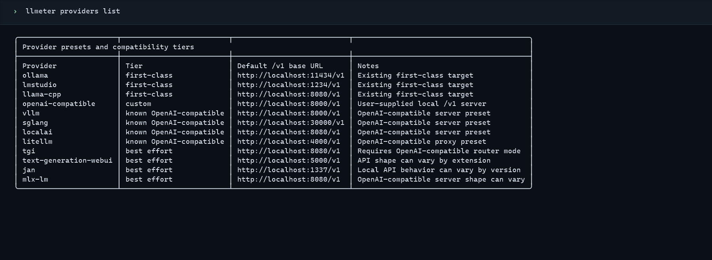
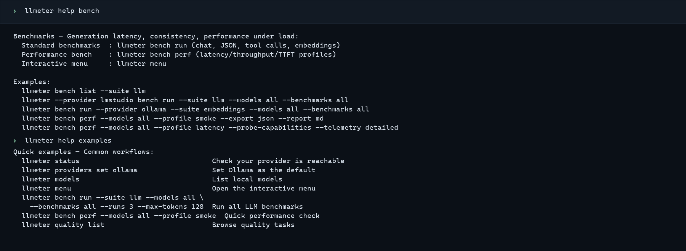

<div align="center">

# LLMeter

A Rust CLI for benchmarking local and custom OpenAI-compatible model servers.
[](https://github.com/CTCycle/LLMeter-local-benchmarks/stargazers) [](https://github.com/CTCycle/LLMeter-local-benchmarks/commits) [](https://github.com/CTCycle/LLMeter-local-benchmarks/releases) [](LICENSE)

[](https://github.com/CTCycle/LLMeter-local-benchmarks/actions/workflows/ci.yml) [](Cargo.toml) [](SUPPORTED_PLATFORMS.md)

[Get started](#get-started) · [Benchmark suites](#benchmark-suites) · [Configuration](#configuration) · [Documentation](assets/docs/project_index.md)

</div>

LLMeter sends requests to a running provider's OpenAI-compatible `/v1` API and records client-side benchmark results. It does not start provider servers or install models. Results depend on the provider, model, host, workload, and run settings; treat them as measurements of those conditions, not universal rankings.

<p align="center">
  
</p>

## Benchmark suites

| Command | What it covers |
| --- | --- |
| `bench run --suite llm` | Chat generation, the Responses API, consistency, prompt sizes, structured output, and tool calling. |
| `bench run --suite embeddings` | Requests to the provider's embeddings endpoint. |
| `bench perf` | Smoke, latency, throughput, and parameter-sweep scenarios with warmups and configurable concurrency. |

The `quality` commands create dry-run plans for external evaluators. LLMeter does not install or run those tools or produce their scores. See [benchmark details](assets/docs/user/benchmarks.md) for metrics, defaults, and limits.

## Get started

You need a running provider with an OpenAI-compatible `/v1` API and at least one exposed model. Start that provider separately before asking LLMeter to list models or run benchmarks.

### Install a release

Download the archive for Windows x86-64, GNU/Linux x86-64, Intel macOS, or Apple silicon macOS from [GitHub Releases](https://github.com/CTCycle/LLMeter-local-benchmarks/releases). Extract the binary and add it to your `PATH`, or run it from the extracted folder. Check the release page and follow the [deployment guide](assets/docs/runtime/deployment.md) to verify its checksum and any published artifact attestation. GNU/Linux archives require a compatible glibc runtime.

### Install from source

With the stable Rust toolchain installed, build and install from a checkout:

```bash
git clone https://github.com/CTCycle/LLMeter-local-benchmarks.git
cd LLMeter-local-benchmarks
cargo install --path . --locked
```

On Windows, `run_llmeter.ps1` can build when needed and forwards arguments to the CLI:

```powershell
.\run_llmeter.ps1 --provider ollama status
```

### Run a first benchmark

List models exposed by Ollama, then replace `<model-id>` below with one of the returned IDs:

```bash
llmeter --provider ollama models
llmeter --provider ollama bench run --suite llm --models <model-id> --benchmarks chat-generation --runs 1 --export both --report both
```

This runs one chat-generation benchmark and writes measurements in JSON and CSV, with Markdown and HTML reports. By default, files go under `benchmark_results` in LLMeter's home directory.

## Interactive use

Run `llmeter` in a terminal to open the main menu. Use `llmeter bench menu` to open the benchmark workspace directly. The scriptable commands cover the same benchmark and report workflows for shell use and automation.

<p align="center">
  
</p>

## Providers

Ollama, LM Studio, and llama.cpp have first-class presets. The catalog also includes known OpenAI-compatible servers and best-effort presets; support depends on the server's API shape. For another endpoint, use the `openai-compatible` preset with `--base-url`. Run `llmeter providers list` to see all tiers and default URLs.

## Results and privacy

LLMeter saves JSON and CSV measurements and can generate Markdown and self-contained HTML reports. Response previews are off by default, and credential-shaped values are redacted before results are saved. See the [security policy](SECURITY.md) before sharing result files.

## Configuration

| Option | Purpose |
| --- | --- |
| `--provider` / `LLMETER_PROVIDER` | Select the provider preset. |
| `--base-url` / `LLMETER_BASE_URL` | Set an OpenAI-compatible `/v1` endpoint. |
| `LLMETER_API_KEY` | Supply an ephemeral bearer token; it is not persisted. |
| `LLMETER_HOME` | Move configuration and default output files to another home directory. |
| `--output-dir` / `LLMETER_OUTPUT_DIR` | Choose where results and reports are written. |

See [runtime configuration](assets/docs/runtime/configuration.md) for defaults, precedence, timeouts, and provider-specific URL variables.

## Documentation and contributing

Start with the [User Manual](USER_MANUAL.md) or browse the [documentation index](assets/docs/project_index.md). The [supported platforms guide](SUPPORTED_PLATFORMS.md) describes platform tiers and runtime requirements. Issues and focused pull requests are welcome; see [Contributing](CONTRIBUTING.md).

## License

LLMeter is licensed under the [MIT License](LICENSE).
